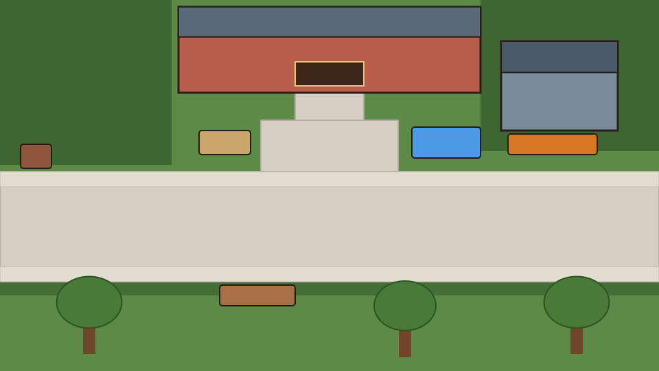

# code-J4 设计案与 AI 受控开发管线笔记

> 本文档整理了围绕 `code-J4`（98仙剑风现代高校微怪谈 RPG）的**剧本构思、世界观、关联机制、人物群像、游戏性创新**，以及针对 AI 辅助开发的**「结构先行（Layout-First）」地图与美术受控管线**方案与实测产物。

---

## 一、 世界观与剧本构思：「校史勘误局」（日常中的微缩怪谈）

`assets/style/bible-campus.md` 的核心美学非常精准：**“1998仙剑质感 + 当代中国大学校园 + 克制的怪谈感（Everyday realism with a faint hint of the uncanny）”**。故事不应滑向宏大奇幻或打怪升级，而应聚焦于**“只有在这所大学待久了才懂的局部异常”**。

### 1. 核心设定：「勘误（Errata）」与「轶事沉淀」
* 江城大学建校百年，几代学生的执念、未寄出的信、毕设卡壳的怨念、被遗忘的社团，会在校园角落沉淀成微小的**“空间错位”**（例如：紧闭的图书馆里，有看不见的东西在自己翻书；或者午夜十二点半，老锅炉房旁边的复古自动售货机会卖出一罐 1998 年的冰镇汽水）。
* **双视角“翻译”搭档**：
  * **林夏（26岁，博一新生 / 校史馆古籍修复助教）**：带着一点疲惫的社畜/延毕人气质（对应 `[tired]` 语音标签）。她本想安稳度日，却因为能“听懂”尼卡喵叫背后的语意，被迫成为校园异常事件的记录者。
  * **尼卡（美国短毛猫，银虎斑加白，四只白爪子）**：校园地头蛇与隐秘巡逻员。猫并不觉得这些异常是“魔法”，猫只觉得这些异常“挡了我的晒太阳路线”或“吵到我睡午觉了”。校园各处的银灰色**猫爪贴纸**，实际上是尼卡标记“空间裂缝/异常锚点”的路标。

### 2. 三幕微箱庭叙事结构
* **第一层 · 午后日常（Day Layer）**：跑腿、办手续、跟门卫/宿管/超市店员交涉，收集情报与日常小道具（小鱼干、一元硬币、旧借书卡）。
* **第二层 · 逢魔交界（Dusk/Night Layer）**：集齐特定线索（如找齐 3 张猫爪贴纸 + 听懂门卫评书里的暗语）后，同一张地图切换 BGM 与暮色/夜间色调滤镜，原本锁闭的场所（图书馆内部、校史馆、宿舍地下室）开启。
* **第三层 · 校史还原（Resolution）**：解谜与交锋的目标不是消灭怪物，而是把错位的物品或记忆归还给正确的人或时间节点，完成“校史勘误”。

---

## 二、 关联机制与游戏性创新（基于 Ink + Phaser 4 架构）

在现有 `main.ink` + `@command` 架构基础上，只需轻量扩展即可实现高密度叙事交互：

### 1. 「人话 vs 猫语」双声道社交（Perspective Switching）
* **机制**：人类 NPC 对林夏说话往往是客套的社会人话术（如“内部整理，暂停开放”）；但若尼卡在场（`nika_trust >= N`），尼卡会直接拆穿或嗅出物理细节（“门卫鞋底沾着校史馆后院的青苔，他十分钟前刚从那儿出来”）。
* **交互分支**：面对同一 NPC，玩家可选 `[林夏上前交谈]` 或 `[示意尼卡去蹭裤腿]`。人类防备人类，但对猫毫无防备。

### 2. 环境回响解谜（Ambient-Driven Puzzles）
* 现有引擎已支持 `@scare`（按自行车铃惊飞麻雀）与 `Ambient.ts`（草叶摇摆、微尘、喷泉水波纹、隐藏点反光 `glint`）。
* **机制升级**：将环境动效直接转化为解谜开关。例如：门卫老周一直盯着校门口，无法查看他的登记簿；若先按车铃（`@scare`），惊飞的麻雀落在门卫室窗台，老周出来轰鸟（`@walk zhou to=bird_spot`），林夏即可趁机调查窗口。

### 3. 将 `@battle` 改造成「98仙剑式·言灵与气场交锋」
* 现代高校背景下，回合制战斗可包装为**“打破怪谈执念 / 应对行政刁难 / 猫爪驱祟”**：
  * **林夏技能**：`【出示学生证】`、`【引经据典】`、`【装傻充愣】`、`【投喂小鱼干（增益尼卡）】`。
  * **尼卡技能**：`【哈气威慑】`（降敌方攻击）、`【踩奶安抚】`（回血/清 Debuff）、`【亮出白爪】`（暴击拆穿幻象）。
* **多结局叙事流**：在 `commands.ts` 的 `battle_result`（`win` / `lose`）基础上增加 `pacify`（安抚成功）。战败不触发死板的 Game Over，而是直接流入 Ink 剧本的狼狈分支（如“被宿管赶出走廊，损失一包小鱼干”）。

---

## 三、 人物群像设计（高辨识度、低美术成本）

每个角色兼具**“高校日常身份”**与**“校园怪谈切面”**：

* **林夏（主角）**：26岁，刚经历社会毒打回到象牙塔的人。平静、冷幽默，槽点都在内心独白里。
* **尼卡（核心搭档）**：银虎斑加白美短。自视甚高，认为江城大学是它的封地，校长只是帮它交电费的。
* **门卫老周（校门）**：表面是听评书、找胖猫的普通保安；实际上收音机里的评书（“且听下回分解”）句句对应校园里正在发生的异常事件，他是上一代“校史勘误员”。
* **超市店员小橘 / 橘子（梧桐苑，`cast` 已备立绘）**：永远趴在收银台打瞌睡的勤工俭学学生。无论几点去，只要拿对应的硬币或“校园传闻”交换，她都能从柜台底下摸出关键道具（十年前的旧校报、生锈的铜钥匙）。
* **“不露面的宿管”（梧桐苑）**：永远贴着“十五分钟后回”的纸条。全程通过门禁对讲机对话（零新行走图成本，纯靠语音 + 对话框演出），声音极其温柔但规则极其诡异。

---

## 四、 AI 辅助开发：地图交互、前景遮挡与场景动画控制

`AGENTS.md` 中记录的三大历史问题（行走图方向闪烁、地图碰撞与画面脱节、出口被遮挡），根源在于 **“先让 AI 自由画图，人再去凑坐标（Art-First, Data-Second）”**。

通过反转为 **“结构先行，视觉受控（Layout-First, Constrained-Art）”**，可以彻底解决脱节问题。

### 1. 受控地图生成实测（Layout Blockout -> Pixel Art -> 零修改碰撞对齐）

脚本文档见 `tools/maps/layout-blockout-demo.ts`。流程如下：

#### 第一步：在代码中定义精确的世界坐标并导出色块图（Blockout）
先定义 `walkable`（主干道、广场、台阶）、`blocked`（校史馆、旧锅炉房、石碑、荷花池、售货机、长椅）、`triggers`（带 `face` 朝向的交互区）和 `exits`（左右出口走廊），直接渲染为 SVG/PNG 色块图：

* **喂给 Gemini 的纯净几何色块图（Clean Blockout Ref）**：
  

* **带交互区/出口标注的设计图（Annotated Blockout）**：
  

#### 第二步：双参考图受控生成（Style Ref + Layout Ref）
将 `bg_avenue.png`（锁定 98 仙剑斜 45 度正交视角、像素颗粒度与午后色调）作为 Ref 1，将 `1_blockout_clean_ref.png`（锁定空间几何布局）作为 Ref 2，传给 `gemini-3-pro-image`，经过 `960x540` 缩放与 `128` 色量化后处理：

#### 第三步：零手动微调，直接叠加第一步的预设碰撞与交互层验证
将第一步编写的几何数据直接叠在生成的像素图上：
* **绿框（Walkable）**：主干道与左右出口 100% 畅通，无任何树木或杂物挡路。
* **蓝框（Triggers）**：校史馆双开木门、赑屃石碑、荷花池、两台蓝白自动售货机、长椅的正面交互区像素级贴合。
* **红框（Blocked）**：建筑、石碑、水池、路牌「← 图书馆」全部严格落在预设阻挡框内。

---

### 2. 前景遮挡（Foreground Y-Sort）机制与优化方案

* **现有机制**：
  * `Actor.ts` 每帧执行 `this.sprite.setDepth(this.sprite.y)`。
  * `Field.ts` 的 `cutout(key, poly, baseline)` 会根据地图 `foreground` 层的多边形，从背景图上裁剪出树冠并设置 `depth = baseline`。当角色走在主路（`y < baseline`）时会被树冠遮挡；走到树干南侧（`y > baseline`）时挡住树。
* **进阶方案（独立绿幕 Prop 图层）**：
  * 在 `3_alignment_overlay.png` 中可以看到，AI 在背景上画树时，蓬松的树冠容易略微超出预设的紫色椭圆裁剪框。
  * **最佳实践**：背景大图只画草坪和地面，不画前景大树；将“梧桐树”、“路灯”作为独立的绿幕资产（`#00FF00` + `chromaKey`）生成透明 PNG `prop`，在地图加载时按 `baseline` 深度直接放置。这样无需手绘裁剪多边形，每一片树叶边缘都能实现像素级精准的 Y-sort 遮挡，且可在多张地图间复用。

---

### 3. 场景交互动画的三种低成本实现路径

依托现有的 `Ambient.ts` 与 `@command` 架构，添加场景交互动画可分为三个梯度：

1. **零美术成本：纯代码像素微动画（Procedural Pixel FX）**
   * 复用 `Ambient.ts` 的 `SPRITES` 像素字符矩阵与 `Pool` 水波纹绘制器：
   * **荷花池互动**：直接复用 `fountain` 的蓝色像素采样与椭圆涟漪（去掉喷水粒子），加上几个在水面下缓慢游动的橙色像素块（锦鲤），玩家调查或投喂时鱼群聚拢并浮现水波纹。
   * **自动售货机买饮料**：触发 `@sfx can_drop` 时，对售货机局部区域做轻微震动，出货口闪烁白光并滚出 `4x6` 像素的易拉罐贴图。
   * **建筑窗户灯光**：黄昏/夜间模式下，在校史馆窗户坐标叠加暖黄色半透明像素块（`blendMode: 'ADD'`）。
2. **低美术成本：局部状态贴片（State Patch / Prop Swap）**
   * 如“校史馆大门打开”、“公告栏寻猫启事被揭下”：背景大图保持默认状态，用绿幕或局部裁剪生成一张“敞开的木门洞”小贴片，通过 Ink 指令 `@prop archive_door state=open` 控制显隐。
3. **角色演出动作条（Single-Row Action Strip）**
   * 针对“林夏蹲下摸猫”、“尼卡伸懒腰/跳上石碑”等特定演出，无需重绘整张行走表，只需在 `campus.yaml` 中以 `design_nika` 为参考图生成单行 3 帧动作条（`act_nika_stretch.png`），通过 `@act nika stretch` 播放一次后切回站立帧。
