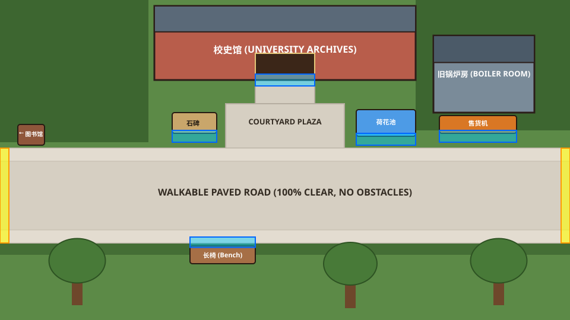
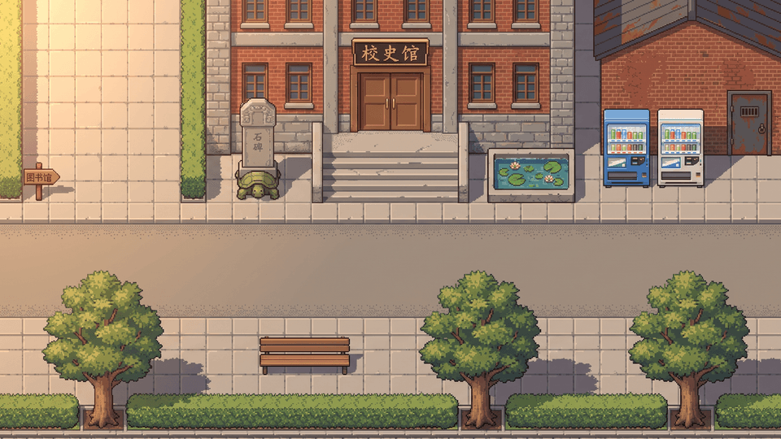
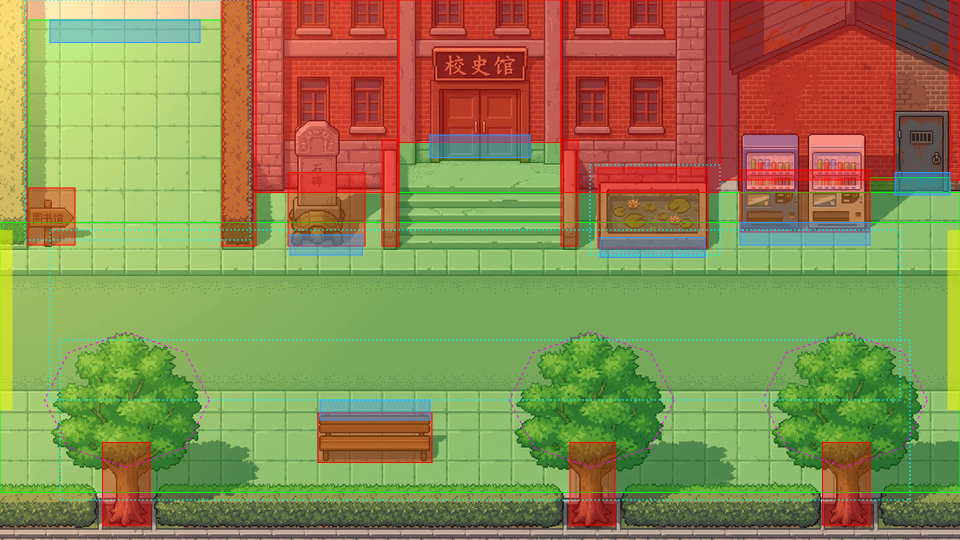
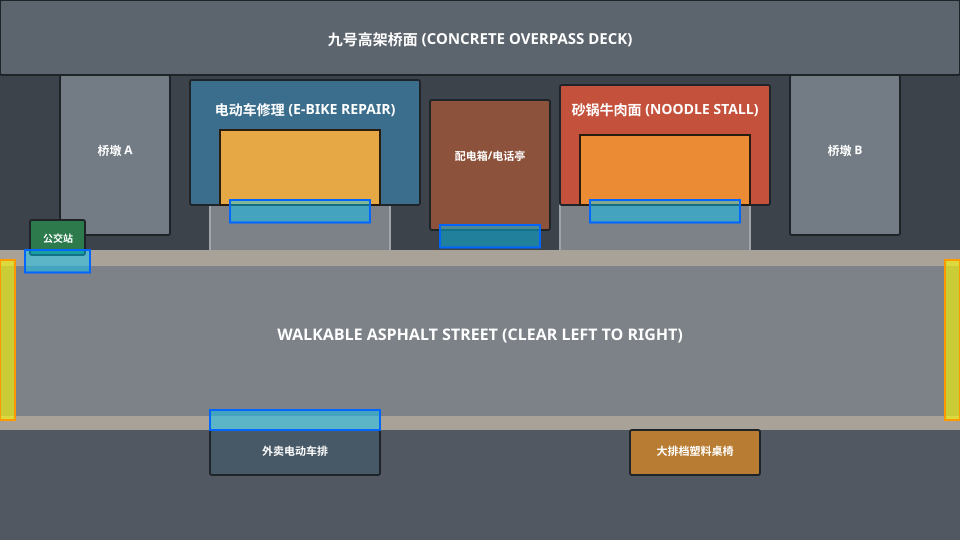
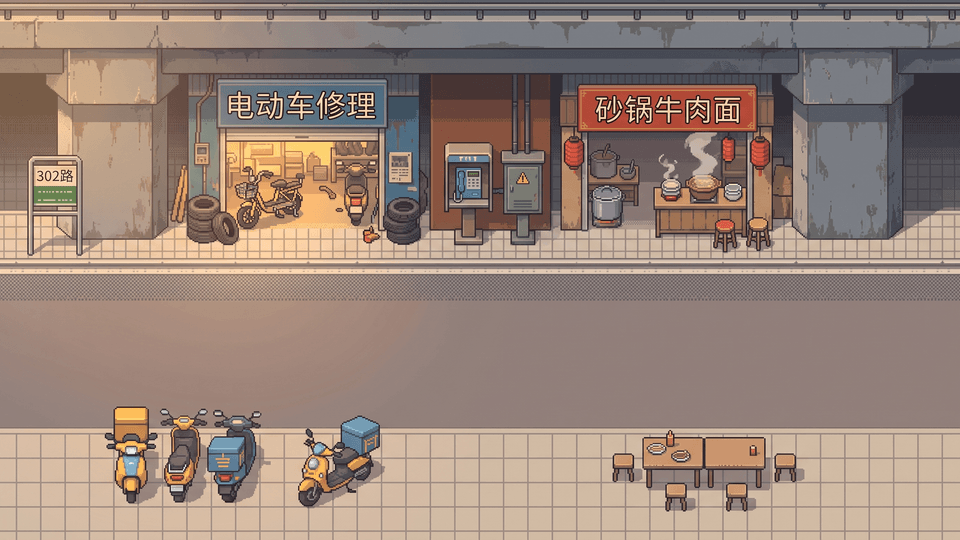
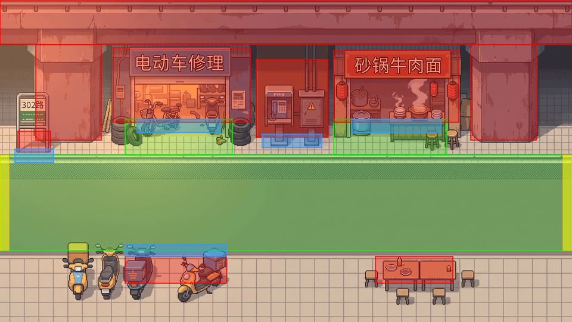
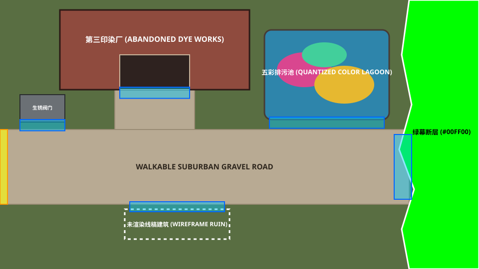
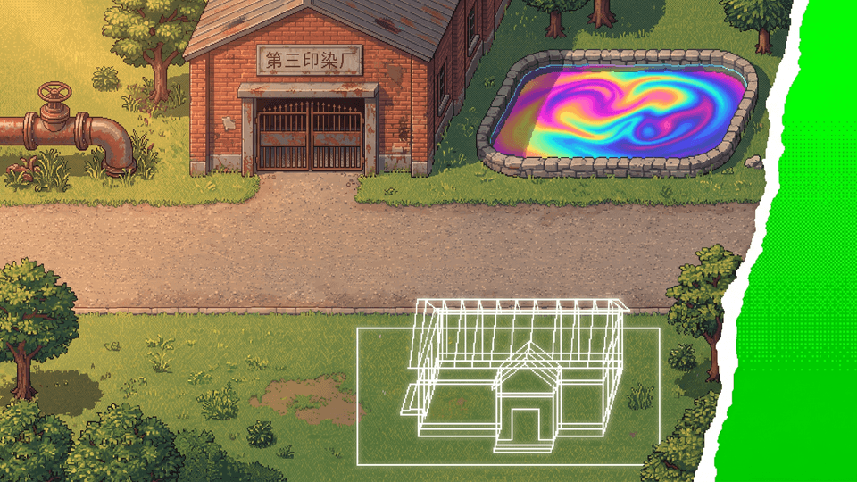
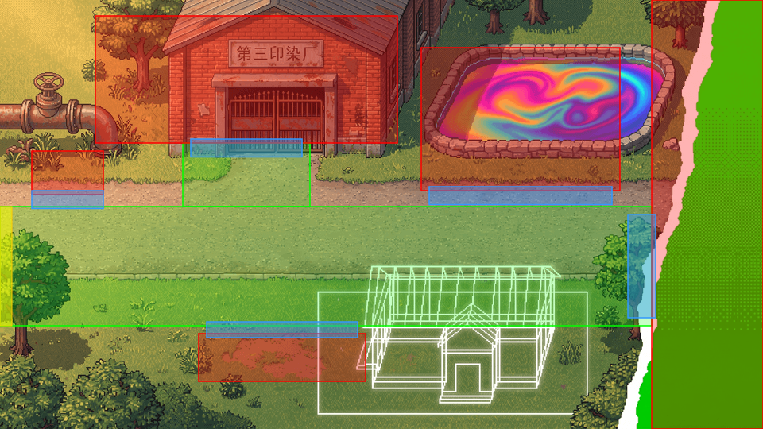

# code-J4 终版设计案：《降维勘探：江城测绘志》（Flatland Blues）

> **核心定位**：98仙剑怀旧像素美学 × 《极乐迪斯科》冷面侦探与颅内群像 × 卡尔维诺式几何奇幻 × 2D像素本体论（Meta-Pixel Ontology）。
> **版图结构**：从**「江城大学旧校区」**出发，顺着一条逐渐退居幕后的失踪案线索，扩展至**「江城老城区（高架桥底、筒子楼、轮渡码头）」**与**「未渲染的市郊荒原（印染厂、线稿别墅区、绿幕防波堤）」**。

---

## 一、 核心世界观：把 2D 引擎的物理限制变成宇宙法则

不靠廉价的催泪或说教去表现当代青年的困境，而是将 `code-J4` 引擎底层的四项技术事实（`Sprite`、`Y-sort`、`Quantize`、`ChromaKey`）直接转化为这个世界的残酷物理法则与黑色幽默：

### 1. 【正面人】与【侧面薄片】—— 扁平化社会学
* **引擎规则**：在 `campus.yaml` 中，人物与猫都是二维切片（Sprite）。左行实际上是右行的水平镜像翻转（`mirror: true` / `flop()`），而侧视图在空间中本来就没有厚度。
* **世界法则**：在江城，一个人的“立体感”是消耗品。经历了长期的标准化规训、填表、打卡与情绪劳动后，青年人会发生**“扁平化（Flattening）”**——只剩下一副朝向镜头微笑的正面（Front Pose）。
* **机制诡计**：
  * **侧身过缝**：如何进入锁死的图书馆或高架桥下的封锁门？当主角学会“承认自己只是一张二维切片”后，可在特定窄缝前将自身 `scaleX` 压扁至 `0.08`，像扑克牌一样侧身切入画面夹层。
  * **镜像不在场证明**：目击者声称嫌犯往东走左肩背包，往西走右肩背包，怀疑是双胞胎作案。实则在这座城市里，大多数人连一套独立的左行帧都负担不起，往左走只是往右走的镜像翻转。

### 2. 【Y-Sort 遮挡阶级】—— 谁站在南边，谁就遮挡一切
* **引擎规则**：`Actor.ts` 每帧执行 `this.sprite.setDepth(this.sprite.y)`。在 `1920×1080` 的画布上，谁的 `y` 坐标越大（越靠屏幕下方/南侧），图层优先级就越高；`foreground` 层按 `baseline` 切割遮挡。
* **世界法则**：大人物永远站在画面南端（`y > 900`）占据绝对前景；而落魄的、想从社会视野里消失的人，只要躲进北侧阴影或卡在前景树冠/高架桥的 `baseline` 背面，在光学与行政意义上就彻底隐形了。
* **猫爪贴纸的真正作用**：尼卡贴在树干背面、超市墙角、花坛边缘的银灰色猫爪贴纸，是钉住两层画布的**“图钉”**。揭开贴纸，就能掀起背景图层的一角，看见藏在 `depth < 0` 夹层里的走私客与隐士。

### 3. 【色板配额制（Quantization）】与【绿幕吞噬（Chroma-Key）】
* **引擎规则**：`tools/lib/image.ts` 会对背景强制执行 `quantize: { colors: 128 }`，并用 `chromaKey` 将 `#00FF00` 绿幕抠成透明。
* **世界法则**：
  * **融化进背景（The Baked-In）**：当一个年轻人的生活单调到极点（穿灰衣、走灰路、连续三天坐在同一把长椅上不动），他的像素就会在下一次世界重绘（Quantize）时被合并进背景底图里，字面意义上“活成了一截墙根或一棵梧桐树”。
  * **绿幕荒原（The Unrendered）**：在市郊边缘，世界尚未完成渲染（或已被“清样工程队”涂抹），草地与道路在撕裂的白纸边缘后突然变成刺眼的 `#00FF00` 纯绿幕。

---

## 二、 人物群像与命名体系（冷感、几何与印刷质感）

彻底摒弃网文样板名，采用带有测绘、光学、印刷与年代错位感的名字：

### 核心搭档与“颅内四维直觉”
* **【迟昼（Chí Zhòu）】**（主角，26岁，前古建测绘员 / 散工调查员）
  * 名字寓意“迟到的白昼 / 停留在下午四点半的人”。身穿橄榄绿旧飞行夹克，习惯把一切悲欢换算成比例尺与像素网格。
  * **她的 4 个颅内声音**（在 `cast.yaml` 中注册为无实体 Sprite 的脑内插话角色）：
    1. **【斜四十五度（Oblique 3/4）】**：空间解构者。时刻提醒迟昼“所有的建筑都只有正脸，没有后墙”，专找地图碰撞框与视觉盲区。
    2. **【色板审计（Palette Audit）】**：通过数一个人身上占用了几种颜色来判断其精神与经济处境，能一眼揪出伪装成背景贴图的隐士。
    3. **【帧率与卡顿（Frame Skip）】**：微表情切片机。从 NPC 说话或走路时的掉帧、抽搐中看穿谎言。
    4. **【硬币反面（Reverse Coin）】**：冷面笑匠与市井算计。当所有人在谈论二维宇宙的哲学危机时，它只关心尾款能不能结清。
* **【尼卡（Nika）】**（银虎斑加白美短，黑市代号：**「四白 / 银刮刀」**）
  * 四只白爪子，唯一不受二维透视法则束缚的生物。对人类的存在主义内耗嗤之以鼻，只收小鱼干，能用爪子刮开粘连的图层或嗅出哪页书里有失踪者的烟草味。

### 校园、城区与市郊群像
* **【陆折（Lù Zhé）】**（最初的失踪者，24岁）：“折”即印刷折页（Octavo）。开局的麦高芬，所有人以为他欠债人间蒸发，实则他嫌三维生活太费像素，侧身滑进了旧书页的夹缝里。
* **【钟守愚（老钟）】**（校门传达室“校平员”）：收音机里从不放正常评书，而是监听整座城市背景图层发生“像素错位”的电流杂音。
* **【姜拓（拓片）】**（校园超市老板 / 夹层走私客）：总在打瞌睡的少女。利用小卖部收银台下的暗格，把快要被抹平的人事物“拓印”在独立包装的小鱼干袋子背面。
* **【焦距（焦大夫）】**（校史馆旧锅炉房光学技师）：靠焚烧过期底片制造烟雾（`motes`），阻止老校区被高分辨率网格同化。
* **【季半拍】**（城区·九号高架桥底修车铺老板 / “抽帧师”）：表面修电瓶车，背地里帮赶时间的外卖骑手做“抽帧加速手术”（切掉中间帧换取双倍移速）。
* **【沈渡】**（城区·江滩轮渡船长）：开着一艘只能左右平移、永远无法转向的铁壳渡船，在图层夹层里走私被城市禁用的“九十年代高饱和度色彩”。
* **【顾白描】**（市郊·线稿别墅区公社社长）：迟昼的建筑系师兄。搬进了开发商跑路、只画了白色 `blocked` 线稿而没上贴图的烂尾别墅区，在透明的线条房子里用粉笔生火做饭。

---

## 三、 叙事漏斗：失踪案如何自然退居幕后？

1. **第一幕（0%–20% · 旧校区）：麦高芬开局**
   * 迟昼受托进入即将清退的江城大学老校区寻找失踪三天的**陆折**。在尼卡的引导下揭开三张猫爪贴纸，发现图书馆地砖下渗出铅字，线索指向围墙外的城市地下管网。
2. **第二幕（20%–70% · 城区与市郊）：卷入二维生态浩劫**
   * 走出校门搭乘 302 路公交，迟昼走遍**九号高架桥底**、**无背面筒子楼**、**轮渡码头**与**市郊第三印染厂**。
   * 陆折的个人行踪逐渐不再重要，因为迟昼已经深度卷入【贴图移民】、【背街走私客】与【清样工程队】三方围绕“城市最后 128 色配额与绿幕防波堤”的荒诞博弈。玩家忙于帮高架桥下的骑手找回丢失的中间帧、帮印染厂疏通五彩颜料池、帮线稿镇居民加固粉笔屋顶。
3. **第三幕（75% 处 · 顺理成章的偶遇）：第 312 页的陆折**
   * 为了查清市郊排污管网的原始走向，迟昼翻开一本无人问津的《1997年江城水文年鉴》第 312 页。
   * **反高潮处理（Anti-Climax）**：没有任何破案的惊呼或煽情音乐。陆折就安安静静地像一枚书签一样，横躺在第 312 页“七月降水量柱状图”下面，拿一行小号宋体注释当枕头。
   * 在玩家眼里，此刻“一个人躺在书页里”已是这个世界再正常不过的日常。迟昼平静地跟他聊了两句，借走了他身下压着的石棉管网图纸，顺手帮他把书签往后挪到印着大海的第 315 页，然后合上书，转身去处理迫在眉睫的市郊绿幕决口。

---

## 四、 三环世界版图与 AI「结构先行（Layout-First）」实测图集

全部地图均采用 **代码几何定义 (`1920x1080`) -> 纯净色块草图 (`960x540`) -> `gemini-3-pro-image` 双参考生成 -> 128色量化 -> 零手调碰撞叠加验证** 管线生成（脚本见 `tools/maps/layout-blockout-demo.ts` 与 `tools/maps/gen-expansion-maps.ts`）。

### 1. 校园拓展篇：【江城大学 · 校史馆与旧锅炉房】
* **功能定位**：连接图书馆与地下管网的枢纽；包含校史馆木门、旧锅炉房（焦距所在地）、赑屃石碑、荷花池、复古蓝白售货机。
* **色块设计图（Annotated Blockout）**：
  
* **生成的 98 复古像素背景（Retro Background）**：
  
* **零修改 1:1 碰撞与交互对齐验证（Alignment Overlay）**：
  

---

### 2. 城区篇：【九号高架桥底 · 帧率黑市与夜市】
* **功能定位**：走出校门（302路公交站）后的第一个城区核心街区。上方是横贯画面的水泥高架桥与桥墩，桥下嵌套着季半拍的「电动车修理」铺、贴满小广告的公用电话/配电箱、热气腾腾的「砂锅牛肉面」夜摊，下方人行道停着一排外卖电瓶车与大排档塑料桌椅。
* **色块设计图（Annotated Blockout）**：
  
* **生成的 98 复古像素背景（Retro Background）**：
  
* **零修改 1:1 碰撞与交互对齐验证（Alignment Overlay）**：
  

---

### 3. 市郊篇：【第三印染厂遗址 · 调色盘水塘与绿幕防波堤】
* **功能定位**：城市与虚无交界的远郊荒原。左上方是废弃红砖厂房「第三印染厂」与生锈阀门；右上方是汇聚了全城被抽走色彩的「五彩排污池」；下方草坪上立着一座只有白色 2D 线条、尚未渲染贴图的「线稿建筑（Wireframe Ruin）」；最右侧边缘则是被撕开的白色画布裂口，直接露出底下未渲染的 **`#00FF00` 纯绿幕断层**。
* **色块设计图（Annotated Blockout）**：
  
* **生成的 98 复古像素背景（Retro Background）**：
  
* **零修改 1:1 碰撞与交互对齐验证（Alignment Overlay）**：
  

---

## 五、 前景遮挡与微动画技术方案汇总

1. **前景遮挡（Foreground Y-Sort）**：
   * `Actor.ts` 每帧设置 `depth = sprite.y`；`Field.ts` 的 `cutout()` 从背景裁切多边形并设 `depth = baseline`。
   * 对于树冠、路灯、电瓶车等复杂边缘物体，可采用独立 `#00FF00` 绿幕生成透明 `prop` 贴图，直接按 `baseline` 摆放，彻底免去手调多边形。
2. **三梯度场景交互动画**：
   * **纯代码像素特效（Procedural Pixel FX）**：复用 `Ambient.ts` 的字符矩阵与 `Pool` 椭圆涟漪，实现荷花池/五彩水塘锦鲤游动、高架桥下霓虹灯管电流闪烁、售货机掉易拉罐。
   * **局部状态贴片（State Patch）**：为开门、撕传单、修补绿幕裂口生成局部小图，通过 `@prop <id> state=open` 切换。
   * **单行角色演出条（Single-Row Action Strip）**：如“迟昼侧身压扁滑过门缝（`scaleX: 0.08`）”、“从背景图层剥离带 2px 白边的贴图隐士（`@peel`）”。
