# code-J4 设计案：《降维勘探：江城测绘志》（Flatland Blues）

> **核心定位**：98仙剑怀旧像素美学 × 冷面日常侦探与脑内碎碎念 × 卡尔维诺式几何奇幻 × 2D像素本体论（Meta-Pixel Ontology）。
> **大地图空间观**：「一张新地图」是一个**大区域概念（Region）**，绝不等于单张背景图或一条直线走廊。全作由三大可自由探索的复合片区构成——**「江城大学旧校区」**、**「江城老城区（高架桥与背街片区）」**与**「未渲染的市郊荒原（印染厂与防波堤片区）」**。每个片区均由多张相互连通的子场景（前坪、主街、后巷、院落、室内、地下管网）组成，且单张画布内部具备完整的北、中、南多层 2D 纵深漫游空间。

---

## 一、 核心世界观：把 2D 引擎的物理限制变成宇宙法则

不靠廉价的催泪或说教去表现当代青年的困境，而是将 `code-J4` 引擎底层的四项技术事实（`Sprite`、`Y-sort`、`Quantize`、`ChromaKey`）直接转化为这个世界的残酷物理法则与冷面幽默：

### 1. 【正面人】与【侧面薄片】—— 扁平化社会学
* **引擎规则**：在 `campus.yaml` 中，人物与猫都是二维切片（Sprite）。左行实际上是右行的水平镜像翻转（`mirror: true` / `flop()`），而侧视图在空间中本来就没有厚度。
* **世界法则**：在江城，一个人的“立体感”是消耗品。经历了长期的标准化规训、填表、打卡与情绪劳动后，青年人会发生**“扁平化（Flattening）”**——只剩下一副朝向镜头微笑的正面（Front Pose）。
* **机制诡计**：
  * **侧身过缝**：如何进入锁死的图书馆或高架桥下的封锁门？当主角学会“承认自己只是一张二维切片”后，可在特定窄缝前将自身 `scaleX` 压扁至 `0.08`，像扑克牌一样侧身切入画面夹层。
  * **镜像不在场证明**：目击者声称嫌犯往东走左肩背包，往西走右肩背包，怀疑是双胞胎作案。实则在这座城市里，大多数人连一套独立的左行帧都负担不起，往左走只是往右走的镜像翻转。

### 2. 【Y-Sort 遮挡阶级】—— 谁站在南边，谁就遮挡一切
* **引擎规则**：`Actor.ts` 每帧执行 `this.sprite.setDepth(this.sprite.y)`。在 `1920×1080` 的画布上，谁的 `y` 坐标越大（越靠屏幕下方/南侧），图层优先级就越高；`foreground` 层按 `baseline` 切割遮挡。
* **世界法则**：大人物永远站在画面南端（`y > 900`）占据绝对前景；而落魄的、想从社会视野里消失的人，只要躲进北侧阴影或卡在前景树冠/高架桥的 `baseline` 背面，在光学与行政意义上就彻底隐形了。
* **猫爪贴纸的真正作用**：尼卡贴在树干背面、超市墙角、花坛边缘的银灰色猫爪贴纸，是钉住两层画布的**“图钉”**。揭开贴纸，就能掀起背景图层的一角，看见藏在 `depth < 0` 夹层里的走私客与隐士。

### 3. 【色板配额制（Quantization）】与【绿幕吞噬（Chroma-Key）】
* **引擎规则**：`tools/lib/image.ts` 会对背景强制执行 `quantize: { colors: 128 }`，并用 `chromaKey` 将 `#00FF00` 绿幕抠成透明。
* **世界法则**：
  * **融化进背景（The Baked-In）**：当一个年轻人的生活单调到极点（穿灰衣、走灰路、连续三天坐在同一把长椅上不动），他的像素就会在下一次世界重绘（Quantize）时被合并进背景底图里，字面意义上“活成了一截墙根或一棵梧桐树”。
  * **绿幕荒原（The Unrendered）**：在市郊边缘，世界尚未完成渲染（或已被施工队抹除），草地与道路在撕裂的白纸边缘后突然变成刺眼的 `#00FF00` 纯绿幕。

---

## 二、 人物设定（平实、日常、去中二化）

摒弃生造词与中二代号，全部采用自然平实的日常名字与称呼：

### 核心搭档与脑内职业习惯
* **【林夏】**（主角，26岁，测绘专业出身 / 散工调查员，对应代码 `linxia`）
  * 身穿橄榄绿旧飞行夹克，性格务实、略带疲惫。因为学过古建测绘，看什么都习惯先量尺寸、数色块。
  * **她的 4 种脑内碎碎念**（在 `cast.yaml` 中可注册为无实体 Sprite 的脑内插话视角）：
    1. **【测绘】**：空间职业病。总能看出“这栋楼只有正脸、没有后墙”，专找地图碰撞框、门缝与视觉盲区。
    2. **【辨色】**：对颜色配额敏感，能看出来谁生活太单调、身上只剩四五种颜色，快要融进背景贴图里了。
    3. **【抓拍】**：习惯盯着人的小动作看，从 NPC 说话或走路时的掉帧、卡顿里看穿谁在撒谎。
    4. **【算账】**：冷面现实派。当别人在谈论二维世界的存在危机时，她只在脑子里算房租、公交车费和尾款能不能结清。
* **【尼卡】**（银虎斑加白美短，对应代码 `nika`）
  * 四只白爪子，脾气大，唯一不受二维透视法则束缚的生物。对人类的精神内耗毫无兴趣，只收小鱼干，能用爪子刮开粘连的图层或闻出哪页书里有旧烟草味。

### 校园、城区与市郊街坊
* **【小陆（陆平）】**（最初失踪的大四学生，24岁）：开局的委托对象。所有人以为他欠债失联，其实他嫌三维生活太累，自己侧身滑进了校史馆旧书页的夹缝里睡觉。
* **【老周】**（校门传达室门卫）：整天听收音机评书，顺便留意学校里哪块砖墙或树影又发生了“图层错位”。
* **【小姜】**（校园超市看店姑娘）：总趴在收银台上打瞌睡，私底下帮那些快要被背景同化的人在小鱼干包装袋背面留个拓印备份。
* **【老焦】**（校史馆后院锅炉房师傅）：守着旧锅炉房烧废底片，靠烟囱冒出的烟尘颗粒（`motes`）防止老校区被高分辨率网格抹平。
* **【老季】**（城区·九号高架桥底修车铺老板）：表面修电瓶车，背地里帮赶时间的外卖骑手做“抽帧加速”（抽掉走路中间帧换取双倍移速）。
* **【老沈】**（城区·江滩轮渡船工）：开着一艘只能左右平移、没法掉头的铁壳渡船，往返于老城区与市郊之间。
* **【大顾（顾师兄）】**（林夏的建筑系师兄）：搬进了市郊开发商跑路、只画了白色 `blocked` 线稿还没来得及贴图的烂尾房区，在透明的线条亭子里搭炉子做饭。

---

## 三、 叙事漏斗与开发路线图（Roadmap）

### 叙事三幕结构
1. **第一幕（0%–20% · 旧校区片区）：寻人委托开局**
   * 林夏受托进入江城大学老校区寻找失联三天的小陆。在尼卡的引导下找齐三张猫爪贴纸，穿过图书馆走到后方的校史馆与锅炉房院落，从老焦处得知线索连向校外的老城区与地下管网。
2. **第二幕（20%–70% · 老城区与市郊片区）：卷入二维城市日常风波**
   * 从校门搭 302 路公交进入九号高架桥底夜市、背街筒子楼与市郊第三印染厂。
   * 小陆的去向逐渐退居幕后，林夏忙着处理一连串具体的街坊委托：帮高架桥下的外卖骑手找回被抽掉的中间帧、帮印染厂疏通五彩排污池、去烂尾线稿屋找大顾借管网蓝图。
3. **第三幕（75% 处 · 顺理成章的偶遇）：第 312 页的小陆**
   * 为了查清市郊排污管网的原始走向，林夏翻开一本无人问津的《1997年江城水文年鉴》第 312 页。
   * **反高潮处理（Anti-Climax）**：没有任何破案的惊呼或煽情音乐。小陆就安安静静地像一枚书签一样，横躺在第 312 页“七月降水量柱状图”下面，拿一行小号宋体注释当枕头。
   * 林夏平静地跟他聊了两句，借走了他身下压着的管网图纸，顺手帮他把书签往后挪到印着大海的第 315 页，然后合上书，转身去处理市郊的绿幕裂口。

### 工程开发路线图（4 阶段）
* **阶段 1：管线收口与大区域首批发散实装（当前执行）**
  * 将「Layout-First」地图生成脚本与 `.tmj` 编译器打通，杜绝一维窄走廊，为每张场景开放完整的北、中、南多层 2D 可探索区域（前坪、通道、草坪、摊位绕行、树木前景遮挡）。
  * 将 `archive`（校史馆与锅炉房院落）、`city_overpass`（九号高架桥底夜市）、`suburb_dyeworks`（第三印染厂与绿幕断层）正式接入 `content/maps/` 与 `main.ink`，与 `gate`、`avenue`、`library` 连成可自由穿行的大世界网络，并通过 `npm run check` 全链路校验。
* **阶段 2：大区域子图横向/纵向扩建（World Expansion）**
  * 围绕三大片区概念继续扩展多张连通子图与多层卷轴空间：校园片区扩建「校史馆室内 / 锅炉房地下管网入口」；老城区片区扩建「修车铺后巷 / 无背面筒子楼 / 江滩轮渡码头」；市郊片区扩建「印染厂车间 / 烂尾线稿别墅群 / 绿幕防波堤尽头」。
* **阶段 3：2D 本体论机制与微动画实装（Mechanics & Ambient）**
  * 实装脑内四视角插话 UI、`@flatten` 侧身过缝指令、`@prop` 局部图层揭开与状态贴片、荷花池/五彩排污池涟漪与高架桥霓虹灯闪烁特效。
* **阶段 4：角色精灵图与三幕完整剧本落地（Cast & Full Story）**
  * 按单行 Strip 规范生成老周、小姜、老焦、老季、大顾及特殊状态 NPC（正面人、抽帧骑手）贴图，完成三幕式分支剧本与语音生成。

---

## 四、 三大片区空间架构与 10 屏连片全幅图集

### 空间设计原则：大区域（Region） ≠ 单张图片
1. **区域多图连通网（Multi-Scene Graph）**：每个「新地图」代表一个可深度探索的片区概念（包含主街、院落、后巷、码头、防波堤等 3–4 张横向/纵向互联场景，全作现已实装 **10 张 1920×1080 场景 = 19,200×1080 总世界宽度**），且相邻场景的道路高度、人行道马路牙子、甚至排污铁管高度在 Layout-First 阶段即严格对齐，拼在一起就是一幅连续的长卷。
2. **单图全幅 2D 漫游（Full-Canvas 2D Exploration）**：单张 `1920×1080` 场景严禁退化为只走中间一条马路的横版过道。必须同时开放**北侧建筑前坪/支巷**、**中轴干道**与**南侧林荫步道/夜市摊位/草坪**，配合精确的 `blocked` 障碍框与 `foreground` 前景遮挡层，让玩家可以绕到树后、穿行于电动车与夜宵桌椅之间、走进北侧筒子楼窄巷或南侧线稿亭。

### 全世界 10 屏连片总览图（World Atlas Stitched & Collision Overlay）
* **10 屏纯享连片全景（`world_atlas_stitched.png`）**：
  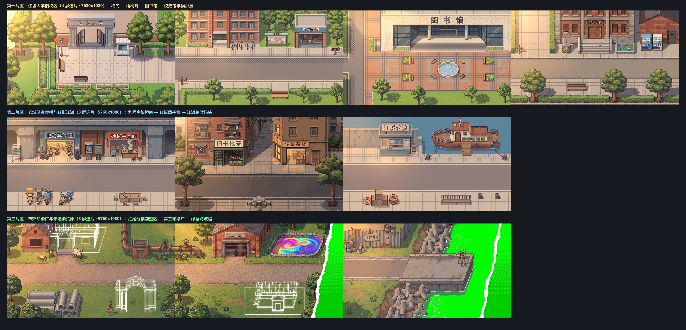
* **10 屏 2D 可行走/碰撞/触发器/出口全叠加图（`world_atlas_overlay.png`）**：
  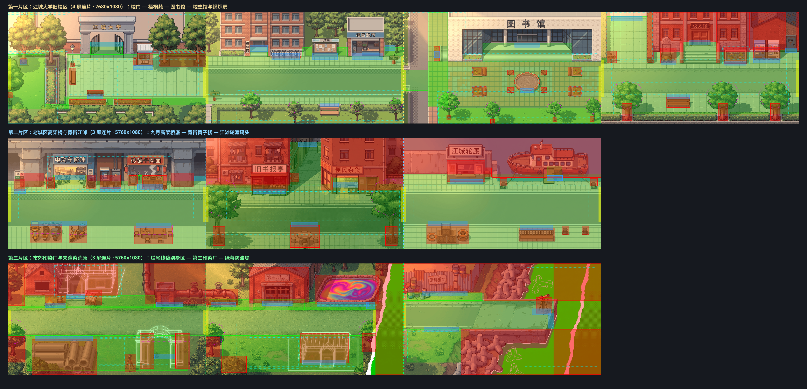

---

### 第一片区：【江城大学旧校区】（4 屏连片：`gate` — `avenue` — `library` — `archive`）
* **4 屏横向拼接长卷（`region_1_campus_stitched.png`）**：
  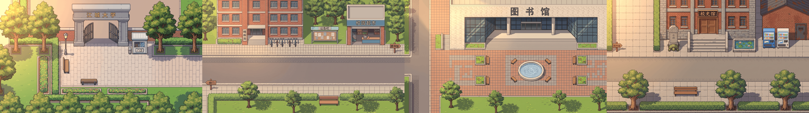
* **拓展场景：`archive`（校史馆与旧锅炉房院落）**：
  * 色块设计图：`./images/1_blockout_annotated.png`
  * 98 复古像素背景：
    
  * 2D 碰撞与交互对齐验证：
    

---

### 第二片区：【老城区 · 高架桥、背街筒子楼与江滩轮渡】（3 屏连片：`city_overpass` — `city_tenement` — `city_ferry`）
* **3 屏横向拼接长卷（`region_2_city_stitched.png`）**：
  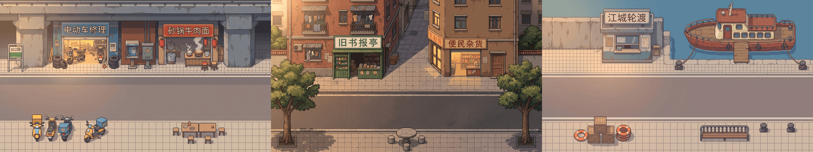
* **子图 2A：`city_overpass`（九号高架桥底 · 老季修车铺与夜市）**：
  
  
* **子图 2B：`city_tenement`（背街筒子楼 · 旧书报亭、北巷与便民杂货）**：
  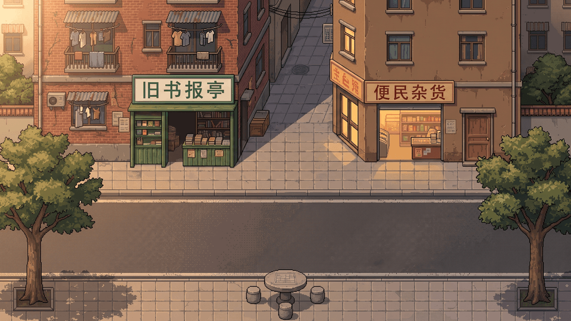
  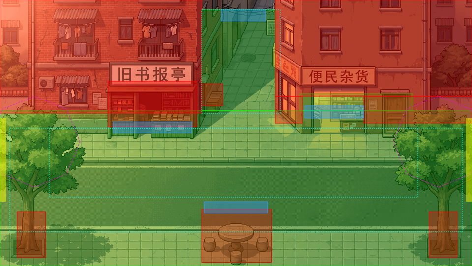
* **子图 2C：`city_ferry`（江滩轮渡码头 · 防洪堤售票亭与老沈铁壳渡船）**：
  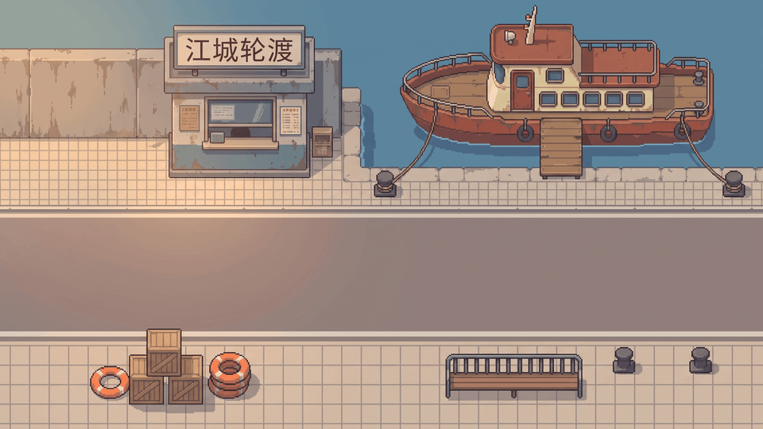
  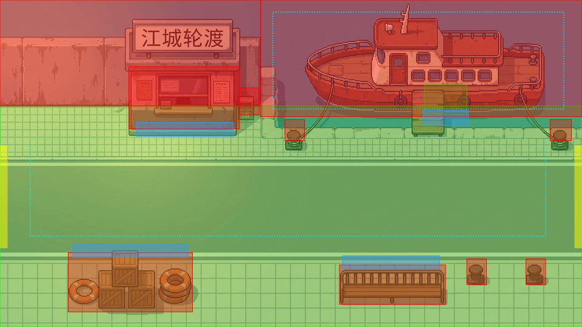

---

### 第三片区：【市郊荒原 · 线稿别墅区、第三印染厂与绿幕防波堤】（3 屏连片：`suburb_wireframe` — `suburb_dyeworks` — `suburb_breakwater`）
* **3 屏横向拼接长卷（`region_3_suburb_stitched.png`）**：
  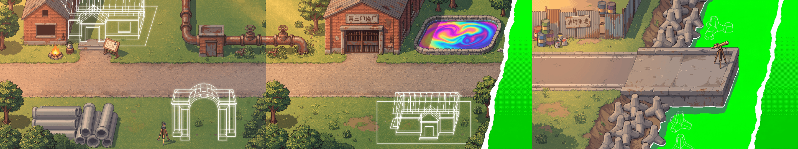
* **子图 3A：`suburb_wireframe`（烂尾线稿别墅区 · 大顾公社与 97 号排污总泵站）**：
  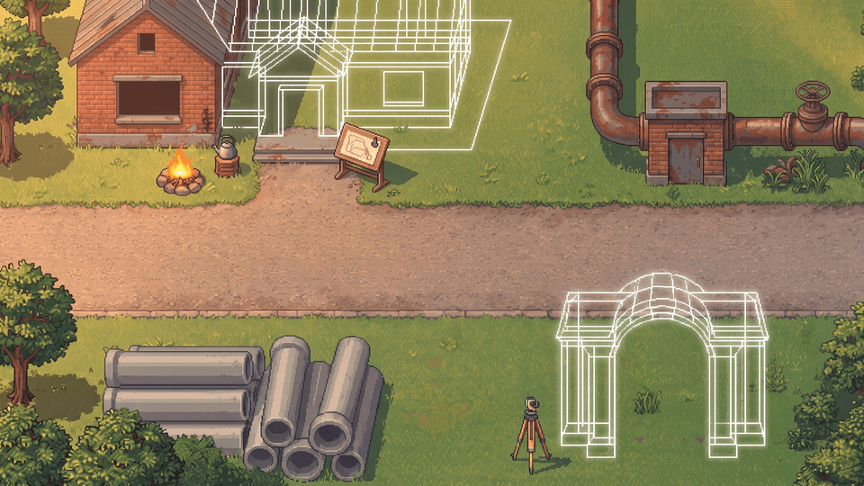
  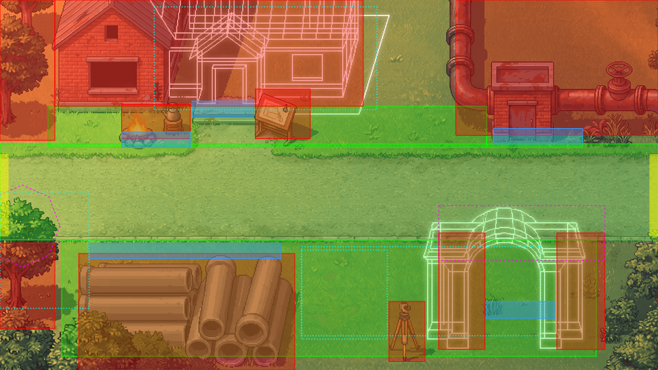
* **子图 3B：`suburb_dyeworks`（第三印染厂遗址 · 五彩排污池与线稿凉亭）**：
  
  
* **子图 3C：`suburb_breakwater`（绿幕防波堤 · 清样重地与 #00FF00 世界尽头）**：
  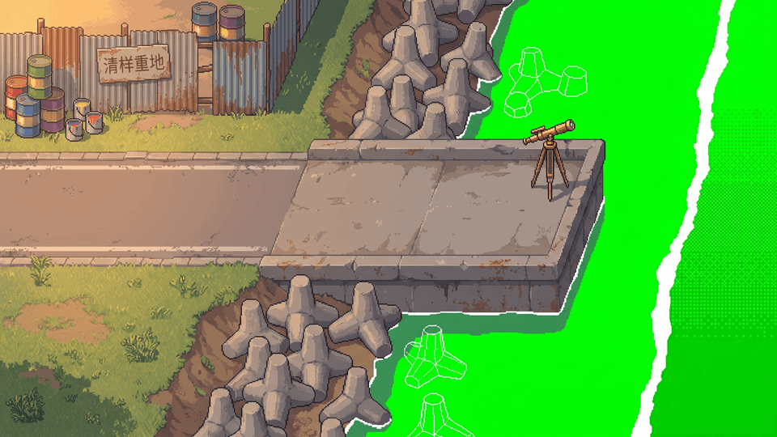
  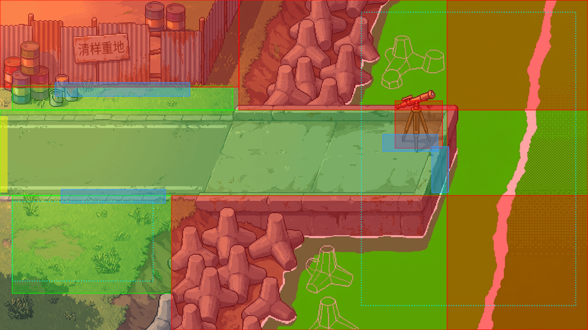

---

## 五、 前景遮挡与微动画技术方案汇总

1. **前景遮挡（Foreground Y-Sort）**：
   * `Actor.ts` 每帧设置 `depth = sprite.y`；`Field.ts` 的 `cutout()` 从背景裁切多边形并设 `depth = baseline`。
   * 对于树冠、路灯、电瓶车等复杂边缘物体，既可通过 `foreground` 多边形按 `baseline` 裁切遮挡，也可采用独立 `#00FF00` 绿幕生成透明 `prop` 贴图摆放。
2. **三梯度场景交互动画**：
   * **纯代码像素特效（Procedural Pixel FX）**：复用 `Ambient.ts` 实现荷花池/五彩水塘涟漪、飞鸟惊起、落叶飘落、微尘浮动与隐藏点闪光（`glint`）。
   * **局部状态贴片（State Patch）**：为开门、撕传单、修补绿幕裂口生成局部小图，通过指令切换状态。
   * **单行角色演出条（Single-Row Action Strip）**：如“林夏侧身压扁滑过门缝（`scaleX: 0.08`）”、“从背景图层剥离带 2px 白边的贴图隐士”。
